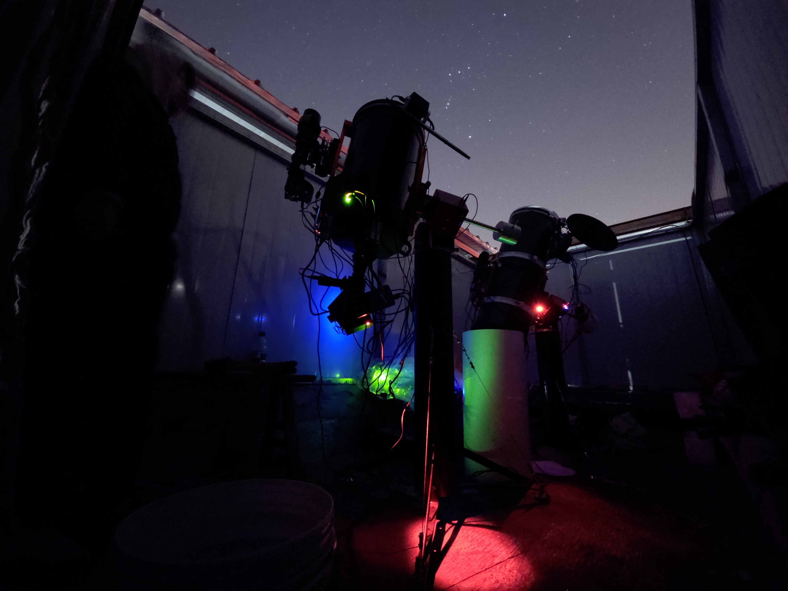
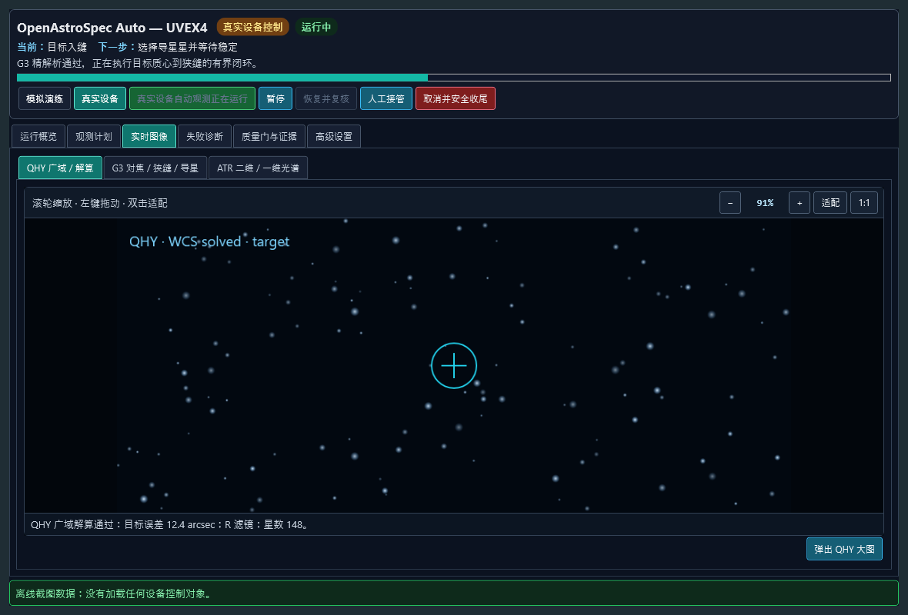

# OpenAstroSpec Auto — UVEX4

[English](README.md) | **简体中文**

[](https://github.com/sedirk/openastrospec-auto-uvex4/actions/workflows/ci.yml)
[](LICENSE)


OpenAstroSpec 是一个开源天文光谱项目家族。本仓库包含 **OpenAstroSpec Auto — UVEX4**：以 UVEX4 为首个完整支持光谱仪实现的自动观测与观测站编排产品，以及配套的离线光谱处理工作台 Spectral Studio。

> [!IMPORTANT]
> 本仓库目前是处于真实硬件 commissioning 阶段的**工程预览版**，不是通用的无人值守天文台安全认证产品。系统默认从模拟和 fail-closed 模式启动。在完成 commissioning 文档规定的站点证据与全部安全硬门之前，真实运动、导星、采集和无人值守科学观测均不可用。

本项目为 UVEX4 地基光谱仪提供开源的 N.I.N.A. 自动观测、设备单一所有权编排、可审计的目标入缝/导星闭环，以及完全离线的光谱处理工作台。默认配置只运行模拟器；真实设备控制必须先完成本机 commissioning、设备身份锁定和逐级安全验收。本项目与 NASA UVEX 空间任务无关，也不是 UVEX4 或 N.I.N.A. 官方发布。

**快速入口：** [观测控制产品](products/observatory/README.md) ·
[Spectral Studio](products/spectral-studio/README.md) ·
[构建与模拟器](#构建并运行模拟器) ·
[真实硬件 commissioning](docs/commissioning.md) ·
[最新软件/验证收口](docs/closeout-2026-10-24.md) ·
[光谱项目资料库](reduction/README.md#光谱项目库采集筛片后期与存储之间的桥梁) ·
[原生光谱整夜序列](docs/native-spectroscopy-night-sequence.md) ·
[可导入的光谱多目标模板](docs/spectroscopy-multi-target-template.md) ·
[光谱中天翻转](docs/native-spectroscopy-meridian-flip.md) ·
[实时光谱提取预览](docs/live-spectrum-preview.md) ·
[SEP 检测与主镜对焦](docs/sep-main-mirror-focus-commissioning.md) ·
[采集计划／曝光预算](docs/acquisition-plan.md) ·
[操作员 SOP](docs/observatory-automation-sop.md) ·
[已知问题](docs/known-issues.md) ·
[0.4.0.80 界面/双语/恢复收口](docs/ui-presentation-localization-and-recovery-2026-08-30.md) ·
[大模型前端闭环接口](docs/model-frontend-closed-loop.md) ·
[参与贡献](CONTRIBUTING.md)

[2026-10-24 收口](docs/closeout-2026-10-24.md)汇总 **0.4.0.309–312** 与离线资料库。
ADR-0043/0044 将重叠拼图、局部双镜模型、曝光时序连续性和有界广域流接入原取场路线，
不补充预算、不放宽设备所有权、天气或停止确认。历史回放与已安装 .312 的空闲验收，
不代表新版已经完成实天恢复验证。

资料库原地关联观测日志、精确科学帧选片和既有后期成果；按项目预览占用及可清理项，
明确区分仅标记、Windows 回收站和永久删除。原始 FITS 与科学依赖保持保护，具体清单
经一个明确确认按钮才执行。普通 Python 回归默认不弹窗口；`--run-ui-tests` 才在
专用测试桌面启用完整视觉回归，CI 保留该覆盖。归档盘未选，不自动迁移原片。

历史[2026-10-22 收口](docs/closeout-2026-10-22.md)汇总 **0.4.0.301–308**：修正傍晚/
晨光方向、亮核与短帧主体关联、换侧恢复、旧终态导星记录及跨段已接受帧显示。
经用户授权，ADR-0041 增加每夜至多一次的严重失焦有界恢复；ADR-0042 在校时成功、
指向未变时先用新的 G3 目标/狭缝证据复核，失败才回退完整定位。原帧、原预算、
多瓣拒绝和完整安全/所有权链保留，不将旧图当新证据。

已安装 **.308**，4,194 项 .NET、75 项后处理测试、Ruff、15 轮/38 帧历史回放及
171 个离线 UI 场景通过。随后操作员自行启动的一轮完成前五个目标、接受十张光谱，
第六个被 AIWeather Unsafe 取消，关顶/停放已确认。该次云量突增与相邻图像和模型
输出不一致，属于待核查的单帧高估疑点，不能宣称已证明误报或已经修复天气模型。
该轮未触发校时或自动对焦恢复，不能代替这两条分支的实天验收；实际面板可视覆盖、
外部赤道仪 UTC 根因仍未结清。本次源码收口不重新安装、重启或启动/恢复观测。

历史[2026-10-15 收口](docs/closeout-2026-10-15.md)汇总 **0.4.0.290–300**：
用同帧实测主星位移保持目标位置连续性，不把移锁命令或多星综合偏差当成实际到达。
ADR-0040 将同锁点稳定恢复限定为每个已扣账阶段至多一次，并完善带原预算的粗精交接、
有限狭缝附近的明确警告试拍。原运动、时间、完整回程预算与完整安全链不变，
**未改暗点源模式**，单次观测和原生序列仍共用一条生产路线。

本批同时包含 ATR 温度恢复、原生选星/SNR 竞态、完成清理和停止确认后的跳目标修复。
分发模板保持 AUTO，每目标可观测窗口预计统一为 **35 分钟**；它不是强制截断长曝的
计时器，也不补充运动预算。汇总报告链接相应设计记录和逐次故障分析。

**3,798 项 .NET、75 项后处理测试及 Ruff 通过**；15 轮/38 张历史接受帧参与指标回放，
169 个离线 UI 场景与 .299 渲染一致。已安装 **.300**，41 个发布文件与运行加载已核对。
这些证据不代表新版实天成功，实际面板可视覆盖仍未验证。
本次 Git 收口不重新安装、不重启、不连接设备、不启动或恢复观测。

历史[2026-10-13 收口](docs/closeout-2026-10-13.md)汇总 **0.4.0.286–289**：
普通光学/预算失败在取场、回程和导星恢复中保留目标级分类，停止期间晚到的取消、
Unsafe、晨光与截止仍阻止下一目标。原生执行回归验证停止与账本确认后下一目标
确实执行，不只验证分类函数；真实设备与天气安全链不变。

ADR-0036 复用原生安全监视器连接/等待卡，明确原生 End 中的收口选择与可编辑的
受保护附加指令组。实际安全收口仍由原整夜/待机所有者执行，不依赖 End 必达。
三份十目标文件和两份保存模板已同步，目标、钟点与开顶选择不变，分发模板默认 AUTO。

**3,564 项 .NET（含五份可选本机文件）、75 项后处理测试及 Ruff 通过**。
已安装 **.289**，41 个发布文件一致，运行加载已核对；九轮/26 张历史光谱对照与
166 个离线 UI 场景属于软件证据，**实际面板可视覆盖和新版实天恢复仍未验证**。
本次 Git 收口不操作设备、不重启应用、不启动或恢复观测。

历史[2026-10-12 收口](docs/closeout-2026-10-12.md)汇总 **0.4.0.278–285**：
每目标固定/自动曝光、清晰光谱图及紧凑状态栏；贯穿取场、入缝与科学帧边界的原生中天
交接；观测序列正常退出后的独立安全待机；校时成功后按原预算重新定位并继续同一目标。
还修复了原生序列采集锁误判、粗定位绕路、目标新帧窗口分类，以及 PHD2 原生选星
尚未完成就交接锁点的竞态。单次和序列仍共用一条生产路线，完整安全链与原始记录保留。

**3,407 项 .NET、75 项后处理测试及 Ruff 通过**；九轮/26 张历史光谱只读对照和
166 个离线 UI 场景验证见收口报告。已安装 **.285**，41 个发布文件一致；接口与启动
日志已核对，**实际面板可视覆盖未验证，新版实天选星恢复仍待验收**。此前 .284 的
HD 21455 已完成 2×600 s，独立待机于 05:01:29 完成截止收口，这些历史结果不归功于
.285。Git 收口不操作设备、不重启软件、不启动或恢复观测。

历史[2026-10-11 收口](docs/closeout-2026-10-11.md)汇总 **0.4.0.261–277**：
仅按钟点重复使用的整夜窗口、独立序列收口与受保护待机、新帧导星恢复、邻场连续性，
以及停止核验后的目标级失败跳过。科学质量 warning 试拍同意与完整设备／天气安全链
分开，不豁免设备所有权、实际停止或运动限额。单次观测和原生高级序列仍共用
**一条生产路线**。[代码审计](docs/reports/2026-10-11-code-audit-and-deduplication.md)
删除重复契约与不可达策略；[职责重构](docs/reports/2026-10-11-observation-workflow-boundaries.md)
明确取场／回程、PHD2 收敛、ATR 试拍和科学计数的状态归属，未宣称庞大 runner 已完全解耦。

**3,214 项 .NET、75 项后处理测试、Ruff 和四份冻结校验通过**。历史测量驱动的只读
回归保留九份有产出记录的原结果及 26 张历史合格光谱；不是新拍摄，也不是完整 FITS
重处理。此前 **.277** 安装时已核对 41 个发布文件散列，158 个离线 UI 场景已查看；
运行加载已确认，但**真实三个面板的可视验收因桌面工具故障尚未完成**。
上次安装快照为空闲、模拟选中、真实控制未授权、设备断开，AIWeather 监视器未连接。
本次源码收口不启动观测、不操作设备；最后一处源码空行清理改变了重建 DLL/PDB
散列，已在收口报告单独记录，没有重新安装。新版实天验收仍待另行进行。

历史[2026-10-10 收口](docs/closeout-2026-10-10.md)汇总 **0.4.0.241–260**：
原生多目标序列、停止确认后的质量失败跳过、有界导星精度警告、台站屋顶/天气策略，
以及独立目标卡片编辑。每个目标独立保存曝光计划和默认关闭的一次性 PHD2 强制校准，
整夜容器只保留夜间设置。ADR-0024 增加逐目标有界导星恢复：弱星场等待、星场恢复后重选，
仍失败则请求一次 PHD2 校准；停止和运动结清后，按目标失败策略决定跳过，不把丢星一律当成整夜退出。
**2,902 项 .NET、75 项后处理测试、Ruff 和四份冻结校验通过**；41 个重建文件与已安装
**.260** 一致，146 个离线 UI 场景通过。此前 .259 的真实原生编辑/另存/重载验收仍属历史证据，
不能代替 .260 的运行加载和实天恢复验收。
最后七轮实测**没有 ATR 科学帧**；PHD2 相机停滞与原生跟踪跳点仍待实机核查。
AI Weather Advanced 已单独升级至 **1.35.0.0**，按要求未备份旧版。软件收口时
N.I.N.A. 与 PHD2 已关闭；未启动观测或机械动作，安装核验不等于实天或安全认证。

历史[2026-10-09 收口](docs/closeout-2026-10-09.md)汇总 **0.4.0.224–240**：
PHD2 自管校准与元数据 warning（ADR-0020）、有界导星窗口／短帧交接修复、曝光计时／
测光连续性、准备界面简化，以及主镜同星配对复核。
**2,619 项 .NET、75 项后处理测试、Ruff 及四份冻结设计校验通过**；独立 SEP 测试
43 通过、2 跳过。已安装 **.240** 的 41 个插件文件与本次重建一致。
用户归位后，N.I.N.A. 已正常退出、测光相机已释放；本次没有新观测、移动设备或重启软件。

**.240** 的 EW Lac 于 01:47 完成：接受 3×600 秒（含 1 张最终试拍复用，原文件哈希
均匹配），另有 260 张同步测光和 2 张定位帧。保留有人监督的入缝精度 warning，
不代表严格入缝、定标科学产品或无人值守认证。随后 78 Psc 在用户确认的云遮挡条件下
取场失败，确认回到搜索起点后取消，没有 ATR 曝光。主镜候选约 4949 未能重复改善，
保留 5000，不宣称其最优。双 N.I.N.A. 测光、无间断多目标／翻转和无人值守仍须分别验收。

历史[10 月 3 日收口](docs/closeout-2026-10-03.md)保留 **.210–.223** 的序列、实时光谱、
温控恢复和完成通知工作，以及原版本的 .220 监督成功和 .223 失败结果。

历史[2026-09-16 晚间收口](docs/closeout-2026-09-16-evening.md)汇总当时安装的 **0.4.0.209**：
主镜焦位改为每轮独立锁定，不再因轮次间调焦错误失效 UVEX 内部校准；保留目录／短帧
交接，区分 PHD2 丢星与真正取帧超时，并将 LED 可见狭缝长度与入缝锚点分开显示。
最终 **2,152 项 .NET、66 项后处理测试通过**，93 个 UI 场景和三处已安装的 N.I.N.A.
原生面板已检查。用户完成硬件归位后，N.I.N.A. 已正常重启，保持**空闲、真实控制未授权、
设备断开**，没有恢复观测。此前自动对焦缺少可比星像的问题及 .209 完整天空运行仍待验收。

[当天凌晨 .205 收口](docs/closeout-2026-09-16.md)保留最终试拍科学复用、积分进度、
校时衔接及首次保存前温度复核的历史证据。

.204 的 WR152 实拍已接受一张 600 秒最终试拍及一张 600 秒正式科学帧；第三张已保存
的 600 秒曝光仍因温度证据冲突未获接受，没有改写原始文件或历史验收结果。
**.205 温度复核分支及新版完整天空运行仍待验收**。此前节点视图、对焦、准备界面与
目录定位工作保留[9 月 15 日的版本化证据](docs/closeout-2026-09-15.md)。

Star Focuser 在 .199 的实测结论是**原焦点验证通过**，不是候选焦点显著改善，也不是
通用的最佳回差参数。.203 的 WR152 坐标导入及保存帧配准回放已通过，
但不能替代新版本完整天空运行的验收。
[9 月 13 日里程碑](docs/closeout-2026-09-13.md)中的 Mirach、γ Cas、Almach 仍按
.181/.183/.190 的三次独立监督运行记录：各 11/11、共 9 张已核对哈希的科学 FITS，保留
入缝精度警告。它不是无间断多目标队列、双 N.I.N.A. 测光端验收、定标光谱、精密测光
或无人值守认证，不能移用为新版的天空成功。

本仓库包含两个面向用户、均采用 GPL-3.0-only 许可的软件产品：

| 产品 | 用途 | 起点 |
|---|---|---|
| **OpenAstroSpec Auto — UVEX4（前期观测控制）** | N.I.N.A. 工作流、设备所有权与编排、commissioning、QHY/G3/ATR 实时诊断及不可变运行证据 | [`products/observatory/README.md`](products/observatory/README.md) |
| **OpenAstroSpec Spectral Studio — UVEX4（后期光谱处理）** | 离线 FITS 检查与处理、二维/一维可视化、波长/响应校准及成品交付 | [`products/spectral-studio/README.md`](products/spectral-studio/README.md) |



_OpenAstroSpec Auto — UVEX4 的开发与 commissioning 实景环境。本照片用于说明项目的物理背景，不代表该站点已经通过无人值守运行所需的安全硬门。_



_上图由离线 UI 测试工具生成，不包含真实设备状态，也不会连接观测站硬件。_

两个产品共享源码历史和科学数据契约，但不共享硬件控制权。Spectral Studio 严格离线。观测控制产品以单一所有权 Windows 服务、独立 WPF 管理器和 N.I.N.A. 3.2 插件替代 DRIVER.UVEX4 的日常控制部分。

本项目是独立的社区软件，不是 UVEX4 项目或 N.I.N.A. 的官方发行版。这里支持的是地基 UVEX4 光谱仪，与 NASA 的 UVEX 空间任务无关。正式公开名称以及为兼容性而保留的 `UVEX-ADV` / `UvexAdv.*` 内部标识，见[品牌与名称迁移策略](docs/project-branding-and-name-migration.md)。

原创源码采用 [`GPL-3.0-only`](LICENSE) 许可。独立应用、驱动、厂商 SDK、科学软件包和观测数据继续遵循各自条款，详见 [`THIRD_PARTY_NOTICES.md`](THIRD_PARTY_NOTICES.md)。公开发布前应完成[开源发布检查清单](docs/open-source-release-checklist.md)；当前操作与发布限制记录在[已知问题](docs/known-issues.md)中。

## 权威采集设计

下一阶段采集自动化的冻结设计基线位于 [`docs/design/observatory-automation-baseline.md`](docs/design/observatory-automation-baseline.md)。各设备的单一所有权决策记录在 [`ADR-0001`](docs/adr/0001-single-owner-device-orchestration.md)，两个光学视场之间可选且版本化的交接规则记录在 [`ADR-0004`](docs/adr/0004-optional-versioned-wide-to-slit-field-transfer.md)。后端/field harness 的成功必须先并入 Dockable 与 Advanced Sequencer 共同使用的生产 runner，并从正式前端重新验收，才能称为产品成功；该规则记录在 [`ADR-0009`](docs/adr/0009-single-production-observation-route.md)。N.I.N.A. Safety Monitor、天气、主光路镜盖和 RRCI 平移顶的两种监督模式及开关顶生命周期记录在 [`ADR-0010`](docs/adr/0010-nina-environment-supervision-and-rolloff-roof.md)。以下规则具有规范性：

- 光谱主控 N.I.N.A. 独占 ATR585M，并协调公共设备和全台流程；
- PHD2 独占 G3M2210M，用于狭缝视场与导星；
- 按 [ADR-0014](docs/adr/0014-dual-nina-coordinated-acquisition.md)，独立测光 N.I.N.A. 拥有 QHYminiCam8M、测光滤镜轮和 GS350 电调焦，不得控制其他公共设备；
- 按 [ADR-0016](docs/adr/0016-verified-configurable-uvex-serial-binding.md)，只有 `UvexAdv.Service` 可以独占明确核验绑定的 UVEX4 串口设备；COM5 仅为历史示例。

从 `.139` 起，源码已接入双实例、受限原生高级序列接收项，以及主控顶部的“同步测光”
总开关。关闭总开关不影响定位所需的广域帧；光谱定位优先，连续测光在曝光、保存和
设备动作完成的边界让路。同一物理相机始终由同一拥有者持有。现有安装必须在明确授权的
空闲边界释放旧服务后才能迁移，不会运行中热切换。配置和限制见
[双实例实现说明](docs/dual-nina-implementation.md)。

从 `.140` 起，测光协同按主控/测光端分步配对；日常名称采用“光谱相机 / 测光相机 /
光谱仪导星相机”，实际型号、稳定身份和历史协议字段不变。通用名称不代表所有型号已
兼容；第一次使用请看[同步测光快速开始](docs/photometry-collaboration-quick-start.md)。
当前光谱页提供全宽预览、折叠显示调节和手动工具，独立一维曲线不随图像拉伸或缩放。
.176 的验证覆盖 1,537 项 .NET 测试、66 项 Python 测试及 38 个离线 XAML 场景；
本次重跑结果和限制见收口说明，真实停靠区域逐一实例化和双实例硬件验收仍单列待完成。

共享生产 runner 已实现 ADR-0010 的源码路线：全无人监管会锁定并自动连接四类 N.I.N.A.
环境适配器，只在新鲜安全/天气/身份/地平线门和赤道仪停放均通过后开顶，并在正常结束或
终端故障时依次关闭镜盖、停放赤道仪、关闭平移顶；有人弱监管按缺失能力逐项 warning
降级，绝不自动开关顶，但已连接适配器明确报告危险仍会阻断。该结论是源码与回归验证，
不代表本机已经完成首次有界真实开关顶验收；实机 commissioning 仍是启用全无人监管前的
必做步骤。

仓库已包含 QHY 服务、PHD2 事件服务器客户端、目标采集状态机以及 N.I.N.A. 真实/模拟运行器。健康阶段无需确认对话框即可自动推进；失败或不确定的安全门进入 `PausedNeedsAttention`。操作员始终可以暂停、恢复、取消或人工接管。必须先完成模拟 commissioning。构建和版本化 Git hook 会校验权威设计哈希，使意外架构修改明确失败。

当前插件已把固定运行栏、两级进度、当前问题、质量门、时间线和证据收敛到同一套语义展示。静态和动态操作员文案跟随 N.I.N.A. 当前选择的界面语言（`zh-*` 或中性英文）；稳定错误码与底层原始消息保持不变，只在默认折叠的技术详情中显示。经审核的临时故障按精确阶段/代码执行有界恢复并受全局次数保险约束，安全、身份、哈希、物理状态含糊和预算耗尽仍保持硬阻断。大模型后台可以通过当前用户专用命名管道读取相同运行状态并触发前端同一个 `ICommand` 白名单；它不能直接调用设备或建立第二状态机。真实流程的进程内授权可以由后台同源命令完成，但每次必须携带操作员明确提供的精确证明，证明不会写入日志。完整边界见[界面、双语与有界恢复收口](docs/ui-presentation-localization-and-recovery-2026-08-30.md)、[自动恢复矩阵](docs/automatic-recovery-matrix-2026-08-29.md)和[大模型前端闭环接口](docs/model-frontend-closed-loop.md)。

当前 GS350/QHY 到 C11/G3 的光轴差绝不会作为编译期常量写入程序。未来可选预定位阶段可以消费由操作员明确选择、带版本和来源的记录；记录必须绑定硬件/安装指纹、环境适用性、不确定度与运动限制。当前生产路线只把 QHY WCS 作为不可变的“不移动见证”，随后获取新鲜 G3 WCS；只有这份 G3 解可以授权 N.I.N.A. 大步修正，并且必须由移动后的另一份新鲜 G3 解证明到达。转移证据缺失或无效时不会发生 QHY 派生的中间运动，也不会静默复用记忆中的偏移。

普通恒星的核心闭环已经在真实天空中两次从单次启动运行到完成；随后 M76 又完成了稀疏邻场恢复、目录 WCS 非恒星入缝、旁星导星和 600 秒发射线光谱。启动后没有人工或大模型纠偏。该结论不声称屋顶与天气系统已经无人值守。证据边界和多节点拼图剩余工作见[2026-08-25/26 M76 实机收口](docs/commissioning-night-2026-08-25.md)与[暗目标/稀疏场设计](docs/design/faint-target-and-sparse-field-acquisition.md)。

仓库贡献、数据隔离和冻结设计规则见 [`CONTRIBUTING.md`](CONTRIBUTING.md) 与 [`AGENTS.md`](AGENTS.md)。当前及规划中的组件地图见 [`docs/repository-layout.md`](docs/repository-layout.md)。

独立打包的 Python 后期处理产品提供 FITS 检查、ASPIRED 提取以及 Spectrum1D/FITS/CSV/PNG 成品，详见 [`reduction/README.md`](reduction/README.md)。它不会访问 COM5 或相机驱动。中文桌面 GUI 可通过 `OpenAstroSpec 光谱处理 - UVEX4` 快捷方式启动，开发环境也可使用 `Launch-UVEX-Spectrum-GUI.cmd`；当前支持使用本地 ISIS 恒星模板数据库进行质量门控的波长校准。已安装的快捷方式指向原生 `.NET 8` 启动器，与管理器快捷方式保持一致，不直接暴露命令文件或 Python 可执行文件。

处理后的光谱按 `reduction/output/目标/YYYY-MM-DD/` 组织。双击 `reduction/output/00-打开结果索引.html` 可打开可视化目录；历史运行和质量研究单独保存在 `reduction/output/_internal/`。

## 安全状态

- 仓库内配置使用 UVEX 模拟器，不会打开 COM5。
- 生产串口使用明确核验的端口/USB 绑定、115200 8N1；打开前排除其他设备预留端口，打开后核验新鲜的 UVEX 固件/描述回读。普通连接和恢复不扫描端口；授权只读维护辨认见 [ADR-0016](docs/adr/0016-verified-configurable-uvex-serial-binding.md)。
- 电机命令还必须持有可续期的独占租约，并满足已配置的软件行程限制。
- 插件以 `Commissioned=false` 启动。光谱分析可用，但在 ROI、谱线、回差和限位测量完成前，闭环电机运动会被阻断。
- 项目有意不提供 EEPROM/网络写入、固件更新、盲扫串口或直接访问 ToupTek SDK 的功能。

## 组件

- `UvexAdv.Service`：仅回环地址 API（`http://127.0.0.1:47844`）、SignalR 遥测、Windows 服务托管、模拟/串口传输、操作审计数据库和滚动 JSON 日志。
- `UvexAdv.Admin`：中文独立管理器，仅通过服务 API 工作。
- `UvexAdv.Nina.Plugin`：N.I.N.A. 面板与高级序列项目。ATR585M 曝光通过 `IImagingMediator` 请求；本项目绝不自行打开 PHD2/G3M2210M。
- `UvexAdv.Qhy.Service` / `UvexAdv.Qhy.Core`：仅回环、单一所有权的 QHYminiCam8M 采集与测光服务，提供不可变 FITS/预览产品、帧指标、幂等任务、控制租约及模拟/回放适配器。
- `UvexAdv.Phd2`：严格的 PHD2 事件服务器客户端，负责 profile/设备/校准安全门、全帧证据采集、导星星选择、导星/settle，以及 Windows profile 绑定证据；它不会自行打开 G3M2210M。
- `UvexAdv.Observatory`：与设备无关的观测计划、地平线/运动安全门、自动阶段协调器、协作式暂停/恢复/取消/接管、狭缝视场分析、commissioning 变换和观测清单。
- `UvexAdv.Reduction.Launcher`：隔离 Python 光谱处理工作台的原生桌面入口。
- `UvexAdv.Spectroscopy`：托管的光谱提取、谱线质心/FWHM、焦点曲线拟合和波长闭环引擎。
- `UvexAdv.Protocol` / `UvexAdv.Core`：有文档的 UVEX 协议、增量解析器、租约、状态机、运动限制与停止行为。

## 构建并运行模拟器

```powershell
powershell -ExecutionPolicy Bypass -File .\scripts\build.ps1
.\artifacts\service\UvexAdv.Service.exe
.\artifacts\qhy-service\UvexAdv.Qhy.Service.exe
.\artifacts\admin\UvexAdv.Admin.exe
```

构建会发布 N.I.N.A. 插件，但不会自动安装。请先关闭 N.I.N.A.，安装插件，再重启 N.I.N.A.：

```powershell
powershell -ExecutionPolicy Bypass -File .\scripts\install-nina-plugin.ps1
```

为兼容旧配置，插件仍安装到 `%LOCALAPPDATA%\NINA\Plugins\3.0.0\UVEX-ADV Spectroscopy`，但在界面中显示为 `OpenAstroSpec Auto — UVEX4`，包含 `OpenAstroSpec 自动观测` 和 `OpenAstroSpec 校准库` 两个面板，以及 `OpenAstroSpec Auto` 高级序列分类。ATR585M 身份绑定和单帧提取检查已并入 `OpenAstroSpec 自动观测 → 实时图像 → ATR 二维/一维光谱`，不再保留独立的占位“光谱”页。文件夹名与插件 GUID 保持不变，因此已有 N.I.N.A. profile 会继续加载同一个插件。

QHY 服务单独安装，默认使用合成模拟器：

```powershell
# 在 scripts\build.ps1 完成后，从管理员 PowerShell 运行。
powershell -ExecutionPolicy Bypass -File .\scripts\install-qhy-service.ps1
```

`-EnableHardware -HardwareConfigurationPath <machine-local-qhy-json>` 会从 QHYCCD 官方完整 AllInOne 安装目录直接加载 x64 QHY SDK，校验其绝对路径和版本化 SHA-256，不再向 UVEX-ADV 服务目录复制第二份私有 SDK；同时要求显式机器本地文件中提供完全匹配且已 commissioning 的 QHY 稳定身份，并且仍只公开 `http://127.0.0.1:47845`。仓库内 `config/qhy.production.json` 是有意设计为不可直接运行的示例。在模拟器、锁定的 Night Setup、PHD2 profile 证据、狭缝几何、天文解析和有界像素到赤道仪变换全部通过 commissioning 前，不要启用真实硬件。

从示例创建被 Git 忽略的 `config/qhy.local.json`，替换全部占位符，再明确选择此机器本地配置：

```powershell
powershell -ExecutionPolicy Bypass -File .\scripts\install-qhy-service.ps1 `
  -EnableHardware -HardwareConfigurationPath .\config\qhy.local.json
```

## 自动目标观测

面向操作员的中文 SOP 位于 [`docs/observatory-automation-sop.md`](docs/observatory-automation-sop.md)，覆盖 Night Setup、校准夹逼、40 度地平线硬门、实时预览、暂停/恢复/取消/接管、证据复核、故障恢复，以及在 Dome/Roof 和 Safety Monitor 输入尚不可用时的监督式 commissioning 限制。

长期问题清单、夜间主题规则、截图矩阵和操作员 UI 验收记录位于 [`docs/observation-operator-ui-acceptance.md`](docs/observation-operator-ui-acceptance.md)。隔离的 WPF 测试工具使用确定性模拟状态渲染真实生产数据模板；它不会构造生产 dockable，也不会联系设备。

`OpenAstroSpec 自动观测` 面板把**设备手控**和**自动观测**明确分开。设备手控保存本机已核验的 UVEX4 服务绑定，但打开服务或面板时不连接硬件；点击`连接`才打开串口并读取位置，点击`断开`后保持断开，不会被后台重新连接。连接后可通过唯一的 `UvexAdv.Service` 完成状态回读、四槽位切缝、狭缝灯和 M2 有界小步进，也可显式释放 UVEX 串口给原厂软件；它不要求 Night Setup、PHD2、QHY、WCS 或整套自动观测 commissioning。自动观测仍提供**模拟自动观测**和**真实自动观测**两种模式及一个模式感知启动按钮；`自动准备`页会从 N.I.N.A. 自动读取已连接设备，把不可变身份/哈希由 bindings 或 Night Setup 文件一次导入，把狭缝等人工决定项做成选择器，并在缺项所在卡片就地标红。完整工程诊断只保留在高级设置，不再作为一整段错误倾倒在主界面。QHY/GS350、PHD2/G3 狭缝视场和 ATR 光谱预览被组织为紧凑标签页，并显示当前阶段、下一阶段、质量门、时间线、证据文件和剩余进度。

目标草稿可以从 N.I.N.A. 构图助手，或 N.I.N.A. 已配置星图软件（包括 Stellarium）当前选定对象中一次性复制。插件把快照规范化为 J2000 度，并记录来源与时间。导入不会连接设备或启动运行，不会更改 Night Setup、commissioning、时长或安全设置，也不会改写已经创建的高级序列容器。在实现面板选择流程前，多画幅构图会被拒绝。

高级序列目标观测容器现在通过 N.I.N.A. 原生 `IDeepSkyObjectContainer` / `InputTarget` 发布同一个目标；ATR 文件仍只由 N.I.N.A. 保存。推荐的当前 Profile 文件模板是 `$$DATEMINUS12$$\$$TARGETNAME$$\$$IMAGETYPE$$\$$DATETIME$$_$$TARGETNAME$$_$$EXPOSURETIME$$s_G$$GAIN$$_O$$OFFSET$$_$$FRAMENR$$`。插件在“高级设置”同时显示当前值和推荐值，只提供显式的应用/撤销按钮，不会在启动时静默改写 Profile。每张 ATR FITS 保存后会被只读重开，复核稳定 `OBJECT`、运行 ID、阶段、采集 ID、Night Setup、图像类型和可选目录身份；不一致时保留不可变原始文件，但不会把它宣称为已接受科学帧。完整决定见 [ADR-0007](docs/adr/0007-nina-native-target-and-image-provenance.md)。

一次正常运行包括：

1. 校验不可变 Night Setup、schema-3 commissioning preset、准确设备身份、环境、覆盖最坏剩余时长的目标地平线、UVEX 位置以及版本化 PHD2 校准质量策略。系统会对当前 active PHD2 校准进行分级，而不是只使用一个正交误差阈值；退化运行和直接目标星导星只能在明确的监督模式下使用。
2. 转到目录坐标，采集并解析不可变 QHY 广域 FITS，但它只作为“不移动见证”。随后获取新鲜 G3 WCS；需要大步修正时，只有该 G3 解可以授权 N.I.N.A. 有界移动，并由移动后的另一份新鲜 G3 解证明到达。单独 commissioning 的广域到狭缝视场记录仍是可选项；记录缺失、无效或被显式跳过时，不会产生 QHY 派生的中间运动。
3. 通过 PHD2 和已 commissioning 的长曝光阶梯采集新鲜 G3 狭缝视场。若 WCS 成功但目标仍在探测器外，系统由 N.I.N.A. 执行有界居中并重新解析；至少包含一个相干源的结构化稀疏视场可进入已配置的小步搜索。零源、云层或透明度不确定的视场绝不授权运动。可选的已校准鬼影匹配可以估计亮目标质心，但不能单独确立目标身份或授权运动。测得目标和狭缝后，首选精细运动权威是当前合格或显式受监督的 PHD2 校准加分段 exact-lock 位移；独立 commissioning 的 G3 像素到赤道仪变换作为后备。普通路径先从新的秒级曝光中选择导星星；只有显式退化路径才在单独 commissioning 的短曝光下直接导超亮目标星。每一阶段都必须 settle，并在新的不可变 G3 帧中重新测量。
4. 启动带租约的 QHY 测光，探测 ATR 光谱 ROI，选择安全的离散曝光档位，通过 N.I.N.A. 保存经过质量门的科学帧，最后仅在 QHY 与 PHD2 终态都已验证后完成运行。

常规流程没有“是否继续？”确认门。`Pause` 会在下一次有界运动或曝光前生效；`Resume` 会重新校验过期安全门；`Cancel` 执行经过验证的清理；`Take over` 释放协调所有权并保持运行暂停。

## ATR585M 暗场/偏置库

在 N.I.N.A. 中打开 `OpenAstroSpec 校准库` 面板。它通过 N.I.N.A. 的 `IImagingMediator` 采集，保存原始 16 位 FITS，写入带 SHA-256 的可恢复 JSON 会话清单；同组至少五帧时可构建流式的“去掉一个最高值和一个最低值”截尾均值 master。它绝不自行加载 ToupTek SDK。

目录键包含相机身份、增益、偏置、binning、读出模式、温度、帧类型和曝光时间。已 commissioning 的 ATR585M 默认值为 gain 100、offset 256、1x1、High Conversion Gain 和 -10 °C。它们必须与科学帧一致；连接相机或读出模式发生变化时插件会停止。Master dark 有意保留相机偏置基座，并以 `DARKBIAS = T` 标记；下游处理不应再次减 master bias，除非先把 dark master 转换为暗电流。

ATR585M 报告没有机械快门，因此每次运行都必须重新、且不持久化地确认镜盖和屋顶已关闭。对于经过确认的无人值守观测站运行，应在启动或重新连接 N.I.N.A. 前提交同样受保护的请求：

```powershell
powershell -ExecutionPolicy Bypass -File .\scripts\request-calibration-library.ps1 `
  -ConfirmDarkness -CameraId '<commissioned-atr585m-device-id>' `
  -BiasFrameCount 32 -DarkFrameCountEach 5
```

请求包含精确 ATR585M DeviceId，并在四小时后过期。只有该相机已连接且空闲时插件才会接受；它不会按设备列表位置选择相机。原始文件默认保存到 `%USERPROFILE%\Documents\UVEX-ADV Calibration Library`。示例中的 `<commissioned-atr585m-device-id>` 必须替换为当前机器 N.I.N.A. profile 中的精确值；脚本不提供硬件身份默认值。

ATR585M offset 决策和已废弃的初始种子运行记录在 [`docs/calibration-library-seed-20260816.md`](docs/calibration-library-seed-20260816.md)。gain-100/offset-16 校准树已被有意删除，不应复用或重建。该相机新的 bias、dark、flat 和 science 帧应使用 offset 256，以确保兼容性键一致。

ATR585M 已于 2026-08-16 使用官方 FPGA 5.0 固件和 ToupCam SDK 60 完成 commissioning。三组独立的重复 ROI 测试——直接 SDK、未经修改的 N.I.N.A. 3.2 设备驱动以及 ToupSky 自带旧 SDK——在升级后都测得帧间位移为零。校验和、原始 FITS、回滚路径，以及为何同一个历史故障同时出现在 ToupSky 和 N.I.N.A. 中，记录在 [`docs/atr585m-sdk-firmware-commissioning-20260816.md`](docs/atr585m-sdk-firmware-commissioning-20260816.md)。

本地 SDK 被 Git 有意忽略。如果 `.dotnet` 不存在，请安装 .NET 8 SDK 8.0.419，或更新 `global.json` 并重新验证 N.I.N.A. 兼容性。

`scripts/install-service.ps1` 默认安装模拟模式，只有显式提供 `-EnableHardware` 才会启用硬件。已有 `%ProgramData%\UVEX-ADV\config.json` 始终会保留。

在已 commissioning 且明确核验 UVEX 绑定的计算机上，先关闭 N.I.N.A.，再双击一次 `Install-UVEX-ADV-Hardware.cmd` 并接受管理员提示。为兼容性保留了旧脚本文件名。安装器会构建并测试项目，安装两个自动启动的 Windows 服务和 N.I.N.A. 插件，并创建 `OpenAstroSpec Auto - UVEX4 Manager` 桌面快捷方式。如果 N.I.N.A. 仍在运行，安装器会在修改任何服务前停止，以免插件与服务版本不一致。插件安装器还会拒绝缺少观测、PHD2 或 QHY 模块的过期发布输出。安装后不要手工启动服务可执行文件，只应打开桌面快捷方式。

## 真实硬件 commissioning

在完成 [`docs/commissioning.md`](docs/commissioning.md) 的全部步骤前，不要设置 `Simulator=false`。DRIVER.UVEX4 与旧名称的 `UVEX-ADV` Windows 服务绝不能同时占用同一个 UVEX 串口设备。

协议实现仅基于公开的 [UVEX4 串口协议](https://spectro-uvex.tech/wp-content/uploads/2022/02/spec-driver-spectro.pdf)。该文档中重复的 `FSTE` 条目被视为歧义；本项目使用无歧义的相对对焦命令 `FGIN`、`FGOU`、`FHOM` 和 `FSTP`。
